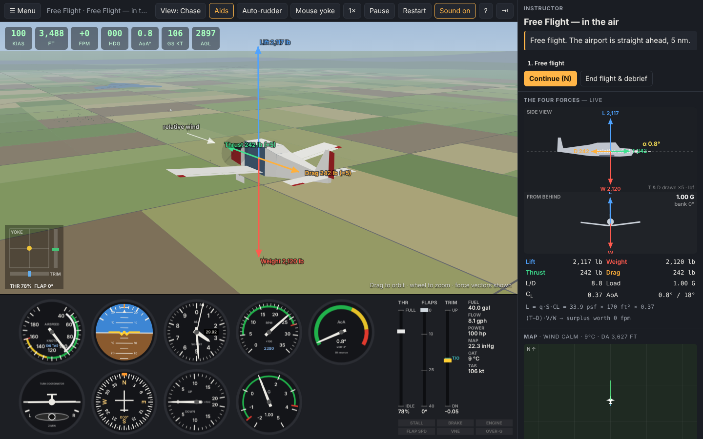
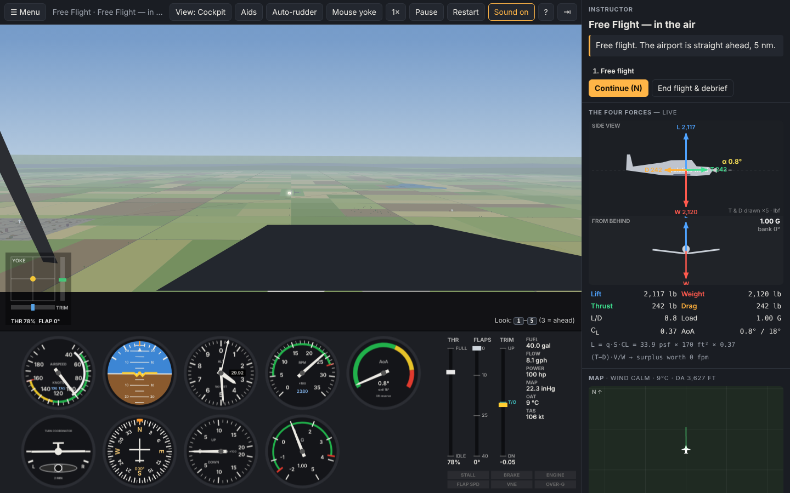

# Pattern Work — a physics-first private-pilot trainer

A browser flight simulator built to teach **why airplanes fly the way they do**, not just how to push buttons.
It models a **PA-28-161 Warrior II**-class trainer with a full six-degree-of-freedom flight model driven by the four
forces — **lift, weight, thrust and drag** — draws it in a lit, shadowed 3D world (WebGL), and wraps it in an
18-lesson private-pilot syllabus (plus three free-flight modes) with ground-school briefings, an on-screen
instructor and grading against the FAA Private Pilot ACS.



No install, no build, no internet needed: it's plain HTML/JS (three.js is vendored in `vendor/`).

## Run it

```bash
# option 1: just open the file
open index.html            # macOS  (or double-click it, or xdg-open on Linux)

# option 2: serve it (some browsers are happier this way)
python3 -m http.server 8080   # then visit http://localhost:8080
```

Use a desktop browser with a keyboard and mouse (a gamepad/joystick also works). It needs WebGL, which every
current browser has; on a slow machine the sim lowers its own resolution to stay smooth.
**Never flown before? Start with Lessons → First Flight: What Each Control Does.**

## Controls (short version)

| Action | Keys |
|---|---|
| Pitch (yoke) | `↓` pull back · `↑` push forward |
| Roll | `←` `→` |
| Rudder / nose-wheel steering | `A` `D` |
| Throttle | `W` `S` (hold; Shift = faster) |
| Trim | `E` nose-up · `Q` nose-down |
| Flaps | `F` down a notch · `V` up a notch (0/10/25/40°) |
| Brakes / parking brake | `Space` (hold) / `B` |
| **Mouse yoke** | click the 3D view or `Y` — mouse position = yoke, wheel = trim |
| Views | `C` cockpit → chase → tower → fly-by · `1`–`5` look left…right |
| Teaching aids | `H` flight-path marker + airflow tufts on the wing |
| Auto-rudder assist | `G` |
| Continue / pause / restart / slow-mo | `N` / `P` / `R` / `T` |

The keyboard yoke is **spring-loaded**: hold a key to deflect, release and it returns to the *trimmed* neutral —
just like a real yoke. That's why trimming matters (and why the mouse yoke is the smoothest way to fly).

## The syllabus

| Group | Lessons |
|---|---|
| Fundamentals | **First Flight: What Each Control Does** (start here) · The Four Forces (live force vectors) · Straight-and-Level & Trim · Climbs, Descents & Level-offs · Coordinated Turns |
| Performance maneuvers | Steep Turns (ACS) · Slow Flight · Power-Off Stall · Power-On Stall · Turns Around a Point |
| Takeoffs & landings | Normal Takeoff · Traffic Pattern & Normal Landing · Crosswind Takeoff · Crosswind Landing · Forward Slip |
| Emergencies | Engine Failure & Glide |
| Performance & environment | Hot & High (density altitude) · Weight & Balance Lab |
| Free flight | Runway · In the air · Touch-and-goes (uses your Weather and W&B settings) |

Each lesson has a **briefing** (the theory, with analogies), a step-by-step **instructor** panel with live
tolerance meters, orange "grease-pencil" **target marks** on the instruments, and a **debrief** with
pass/fail per ACS item, notes, and a chart of your flight.

## Your instructor, the assists and the debrief

**Live instructor.** A CFI sits in the right seat on every flight, lessons and free flight alike
(`js/coach.js`). It speaks up only when an error has lasted a moment, one thing at a time, most urgent
first, and always with the reason: *"More right rudder. At full power and a high nose the propeller
pulls the nose left."* It knows the phases of flight (takeoff roll, climb-out, cruise, approach, flare)
and covers about 25 common student errors: low or slow on final, ballooning, a flat flare, drifting off
the centreline, holding yoke pressure instead of trimming, steep banks low to the ground, spin entry.
The caption clears once you fix the problem. It can also talk aloud (Menu → Instructor & assists).

**Assists.** The physics is always the full model. The one flying assist is **auto-rudder** (`G`): it
keeps the ball centred in the air and the nose on the runway during the takeoff and landing roll, so
you can learn pitch, bank and power first. Your own rudder input overrides it instantly. Turn it off
from *Coordinated Turns* onward. Slow motion (`T`) and calm air (Weather tab) are the other training
wheels.

**Debrief.** Every flight ends with one, including free flight ("End flight & debrief"):

- a 0–100 score, flight time and how many times the instructor had to speak up;
- for any landing, the **approach profile**: your height on final against the 3° glide path, coloured
  by airspeed, with threshold-crossing height and speed and how stable the last half-mile was;
- each touchdown scored on sink rate, touchdown point, centreline, alignment and attitude, with the
  weakest one explained;
- the instructor's call-outs ranked by how often you heard them. The top one is what to practise next.

**Logbook.** Menu → Logbook keeps every flight (stored in your browser) with totals and a score trend
line, so you judge yourself on the trend and not on one flight.

### A suggested path

0. **First Flight** — pitch, roll, yaw, power and trim, one at a time, with auto-rudder on.
1. **The Four Forces** — fly in chase view and watch the vectors. Make thrust < drag and see what happens.
2. **Straight-and-Level & Trim** → **Climbs & Descents** → **Turns** — attitude + power = performance.
3. **Slow Flight** → **Power-Off Stall** → **Power-On Stall** — angle of attack is the whole story.
4. **Normal Takeoff** → **Traffic Pattern & Landing** — then grind **Free Flight — touch-and-goes**.
5. **Steep Turns**, **Turns Around a Point**, **Crosswinds**, **Forward Slip**, **Engine Failure**.
6. **Hot & High** and **Weight & Balance** — the airplane you fly depends on the air and the load.

## What you see

The picture is built from the same numbers the physics uses, so what you see is what the airplane is doing.

- **The airplane.** The wing is a real airfoil section with the Warrior's taper and 7° of dihedral. Ailerons, flaps,
  the all-moving stabilator and the rudder deflect by the angles the aerodynamics is using. The oleo struts
  compress under load, the wheels spin up on touchdown (with a puff of tyre smoke) and the nose wheel steers.
  The propeller blurs into a disc as the RPM rises.
- **Airflow you can watch.** With the aids on, rows of wool tufts sit on the wing, as in a flight test. In normal
  flight they lie flat and blue. As you approach the critical angle of attack they turn red and flail, starting at
  the wing root and trailing edge and creeping outward. That is a stall, seen directly.
- **Force arrows** for lift, weight, thrust, drag and the relative wind, drawn to scale in the chase view.
- **Light and weather.** Time of day from dawn to night, real-time shadows, haze that thins the far distance
  the way real air does, drifting cumulus at a cloud base you choose, and visibility from 3 to 60 miles
  (Menu → Weather → The sky).
- **A world with scale cues.** Crop rows, section-line roads, farmsteads, woods, a town, a lake and a mountain range
  on the horizon. Ground texture gets finer as you descend, which is what lets you judge height in the flare.
- **The airport.** Runway 18/36 with markings and rubber marks, a working PAPI, edge and threshold lights, a
  windsock that swings and droops with the wind, and a rotating beacon.
- **The cockpit.** You sit in the left seat. The glareshield, cowling and windshield posts give you the sight
  picture, and your head moves with G, braking, stall buffet and runway rumble.



## What's actually simulated

Every frame the sim integrates Newton's and Euler's equations for a rigid airplane at **240 Hz**:

- **Weight** — from your loading (pilot, passengers, baggage, fuel; fuel burns off), acting at the computed CG.
- **Lift** — `½ρV²·S·C_L`, C_L from angle of attack with a rounded, PA-28-style stall break and post-stall
  behaviour, plus flaps, pitch rate, downwash lag and **ground effect** (Wieselberger).
- **Drag** — parasite + induced (`C_L²/πAe`) + flaps + sideslip + separated flow beyond the stall.
- **Thrust** — a fixed-pitch propeller modelled with thrust/power coefficients vs. advance ratio, driven by a
  160-hp engine whose power falls with air density. **RPM is an output**, found where engine torque and
  propeller torque balance, so it climbs in a dive and sags in a climb.
- **Moments** — static stability (`Cmα`, `Cnβ`, dihedral `Clβ`), damping, adverse yaw, P-factor and slipstream,
  engine torque, gyroscopic precession, CG-dependent pitch stability (static margin), and a stall break that
  will drop a wing (spin entry) if you stall with the ball out.
- **Ground** — three spring/damper struts with tyre friction, brakes, rudder-linked nose-wheel steering;
  wingtips, tail and prop can strike; hard landings collapse the gear.
- **Air** — a non-standard atmosphere from altimeter setting + temperature (real density altitude), wind with a
  logarithmic boundary layer (less wind near the ground), gusts and Dryden-style turbulence.
- **Instruments** read what they physically sense: pitot pressure (the ASI shows wind on the ground and reads
  low in a slip), static pressure vs. your Kollsman setting, a lagging VSI, a canted-gyro turn coordinator and a
  real inclinometer ball.

### Calibration (gross weight, sea level, standard day)

| Item | Sim | PA-28-161 POH (approx.) |
|---|---|---|
| Stall, clean / full flaps | 51 / 44 KIAS | 50 / 44 KIAS |
| Rate of climb at Vy 79 KIAS | ~700 fpm | ~640 fpm |
| Best glide | ~73–76 KIAS, ~10.5 : 1 | 73 KIAS, ~10 : 1 |
| Max level speed | ~122 KIAS | ~125 kt |
| 75 % cruise at 8,000 ft | ~116 KTAS | ~117 KTAS |
| Takeoff ground roll (flaps 25) | ~1,000 ft | ~975 ft |
| Static RPM / idle RPM | ~2,300 / ~740 | — |

Reproduce with `node tools/calibrate.js`.

## Tests

```bash
npm test        # or: node --test tests/*.test.js
```

The suite checks the atmosphere, W&B arithmetic, trim solver, POH performance, stall speeds and stall warning,
hands-off stability, propeller RPM behaviour, ground handling, takeoff roll (sea level vs. hot & high), hard-landing
detection, ground effect, spin-entry wing drop, the instructor's call-outs (including that it stays quiet on a
well-flown approach), the auto-rudder and the landing scoring — and flies **scripted "student" autopilots** through the takeoff,
straight-and-level, steep-turn and landing lessons to prove they're completable and graded correctly.

## Code map

| File | What it does |
|---|---|
| `js/math.js` | vectors, quaternions, units, seeded RNG |
| `js/atmosphere.js` | non-standard atmosphere, density altitude, wind, gusts, turbulence |
| `js/aircraft.js` | PA-28 data: geometry, W&B, inertia, aero derivatives, engine, prop, gear |
| `js/physics.js` | the 6-DOF flight model, ground contact, trim solver, telemetry |
| `js/world.js` | airport (runway 18/36, PAPI, windsock), farmland, landmarks |
| `js/render3d.js` | the WebGL renderer: cockpit / chase / tower / fly-by cameras, shadows, force arrows, tyre smoke |
| `js/airplane3d.js` | the PA-28 model, built from the flight model's own geometry, and its moving parts |
| `js/scenery3d.js` | sky and sun, haze, terrain, airport, trees, clouds, lights |
| `vendor/three.min.js` | three.js r160 (MIT) |
| `js/instruments.js` | six-pack, tachometer, AoA, G-meter, levers, annunciators |
| `js/diagrams.js` | live four-forces diagram, moving map |
| `js/lessons.js` | the syllabus and the step-by-step lesson grader |
| `js/coach.js` | the live instructor (error call-outs) and the auto-rudder assist |
| `js/debrief.js` | landing scores, approach-profile analysis and chart |
| `js/input.js`, `js/audio.js`, `js/app.js` | controls, synthesized sound, UI and main loop |

## Disclaimer

A learning tool for fundamentals, not a certified training device. Fly the real airplane by its POH, under the
guidance of a CFI.
